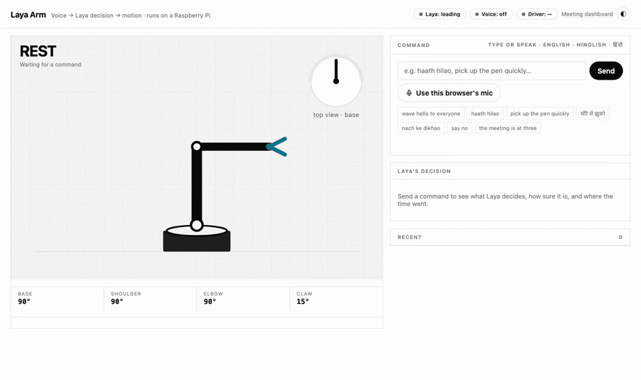

# Pi Meeting Assistant + Laya Arm

Two things that run on one Raspberry Pi 5:

1. **Laya Arm** — say or type a command in **English, Hinglish or Hindi** and a robot arm does it.
   Speech recognition and the decision both run **on the Pi, with no cloud and no API keys**.
   The decision comes from [Laya](https://github.com/NandhaKishorM/laya), a non-generative
   "System 1" model that picks one option from a fixed list in a single forward pass —
   so it can't invent a gesture that doesn't exist.
2. **Meeting assistant** — listens to a meeting room, shows a live transcript on a shared screen,
   and turns the meeting into a summary and work items you review before they go to Teams / Azure DevOps.



▶ [Demo video with sound](docs/demo/demo.mp4)

---

## Laya Arm

```
mic (Pi or browser) ──► Vosk speech-to-text (local) ──► Laya: which gesture? how fast? ──► 50 Hz motion engine ──► servos
                         Indian-English + Hindi           one forward pass, calibrated        eased keyframes,        PCA9685
                         models, both every utterance     confidence, "none" if it's chatter   blend on interrupt      (or on-screen sim)
```

- **Gestures:** wave, point, nod, shake no, bow, grab, release, dance, rest, random — plus **none**
  (meeting talk, chatter: the arm stays still, so it can listen without a wake word).
- **Speed** comes from the same pass: *“dheere se”*, *“quickly”*, *“जल्दी”*.
- **Confidence gate:** below 45% calibrated confidence the arm doesn't move. A wrong gesture is worse than none.
- **Two recognisers, one decision:** every utterance is decoded by an Indian-English and a Hindi model;
  both transcripts go to Laya in one batch and the more confident decision wins.

### Results

Fine-tuned from Laya's multilingual checkpoint on synthetic commands
(`arm/dataset.py`). The test set uses **phrasings and templates never seen in training**.

| Held-out test (135 commands) | Stock Laya multilingual | **Fine-tuned** |
|---|---|---|
| Overall | 43.7% | **79.3%** |
| English | 63.5% | **88.5%** |
| Hinglish (romanised) | 31.1% | **71.1%** |
| Hindi (Devanagari) | 31.6% | **76.3%** |

With the default 0.45 confidence gate the arm acts on 91% of commands and is right **86%** of the
time when it does; it performed a wrong gesture on 12% and reacted to 2 of 18 chatter sentences.
Raw numbers: [`arm/eval.json`](arm/eval.json).

**Speed** — one Laya decision is ~105–190 ms (laptop CPU, Apple M-series); Vosk speech-to-text adds
~0.5–1 s per spoken command. Raspberry Pi 5 numbers: *to be measured* (expect a few × slower).

**Known misses** — short one-word Hindi commands are hard for the small speech model
(*“रुको”* was heard as *“को”*; the gate kept the arm still). *“haan bolo”* (say yes) can come out as
*shake no*. More varied training phrasings is the obvious next step.

### Hardware (~₹1,500)

| Part | Notes |
|---|---|
| Raspberry Pi 5 (4–8 GB) | Laya + Vosk use ~1.5 GB RAM |
| 4-DOF acrylic arm kit | e.g. the common ₹279 laser-cut kit (no servos included) |
| 4 × SG90 / MG90S servos | MG90S for base and shoulder if you can |
| PCA9685 16-channel servo board | I2C; Pi → SDA/SCL/3.3 V/GND |
| 5 V 2–3 A supply for the servos | **never** power servos from the Pi |
| USB microphone | any; set the ALSA card in `asoundrc` |

No hardware yet? Everything runs with the on-screen simulator (`ARM_DRIVER=sim`, the default).

### Run it on a laptop (simulator)

```bash
python -m venv .venv && . .venv/bin/activate
pip install -r requirements.txt playwright
scripts/fetch_models.sh ./models/vosk          # ~130 MB speech models
python -m arm.dataset && python -m arm.train    # fine-tune Laya (~20–40 min on a laptop GPU)
VOSK_MODELS_DIR=./models/vosk MOCK=true python main.py
# open http://localhost:3000/arm
```

Skip training and the arm uses Laya's stock multilingual checkpoint (works, lower accuracy).

### Run it on the Pi

```bash
make deploy-pi PI=user@<pi-ip>     # builds the arm64 image, ships it + the model, starts it
```

Set `ROBOT_MODE=true` in `~/pi-meeting/.env` on the Pi so its microphone drives the arm,
and `ARM_DRIVER=pca9685` once servos are wired. Calibration (channels, pulse range, per-joint trim,
mirrored servos) is env-only — see `.env.example`.

---

## Meeting assistant

- Wake word (“hey jarvis”) or the dashboard starts recording.
- Live transcript streamed to every screen over WebSocket (Sarvam realtime STT, with a chunked fallback).
- After the meeting an LLM drafts the summary and work items; nothing is published until someone approves it.
- Needs cloud keys (`SARVAM_API_KEY`, `LLM_API_KEY`) — the arm does not.

Design notes: [architecture_decisions.md](architecture_decisions.md).

## Layout

```
arm/            Laya Arm: schema, dataset, training, brain (Laya), stt (Vosk), motion engine, drivers, hub
routes/arm.py   /arm page, /api/arm/*, /ws/arm (live pose), /ws/arm/audio (PCM in)
public/arm.html simulator + control screen
scripts/        deploy-pi.sh, arm_voice.py (Pi mic → arm), replay_audio.py, demo/record_demo.py
routes/, services/, public/index.html   meeting assistant
```

## License

MIT — see [LICENSE](LICENSE). Laya is Apache-2.0; Vosk models are Apache-2.0.
